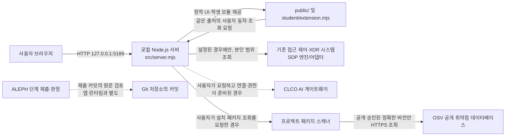

# 크롱 보안 Agent 학생 실행 안내서

이 문서는 현재 프로젝트를 보존하면서 케셰브 보안 Agent를 실행하고, 제공 기능과 학생 구현의 경계를 이해하기 위한 안내입니다. 실행해 화면이 열리는 것은 회사 시스템·AI 게이트웨이·OSV에 연결됐다는 뜻이 아닙니다.

## 프로젝트와 실행 환경

| 항목 | 현재 값 |
|---|---|
| Git 저장소 최상위 | `C:\Users\User\AppData\Local\ALEPH\Workbench\projects\크롱-방아전` |
| 앱 폴더 | `C:\Users\User\AppData\Local\ALEPH\Workbench\projects\크롱-방아전\on-client` |
| 서버 진입점 | `on-client\src\server.mjs` |
| 학생 구현 | `on-client\student\extension.mjs` |
| 브라우저 주소 | `http://127.0.0.1:5189/` |
| 프로젝트가 선언한 Node.js 엔진 | `24.19.0` (`package.json`) |
| 이 문서 작업 환경에서 확인한 버전 | Node.js `v24.21.0`, npm `11.19.0` |
| npm 의존성·잠금 파일 | `package.json`에 의존성 선언이 없고 저장소에 `package-lock.json`이 없습니다. |

시작 스크립트는 Node.js 22~24를 허용하고, `24.19.0`이 아니면 참고 메시지를 표시합니다. 위의 실제 버전은 이 문서 작업 환경에서 직접 실행해 확인한 값이며, 별도 PC의 설치 상태를 보증하지 않습니다. 이 프로젝트는 설치 명령을 요구하지 않으므로 실행 전에 `npm install`을 하지 마세요.

주요 폴더:

```text
크롱-방아전\                 Git 저장소 최상위
└─ on-client\                앱 폴더 및 package.json
   ├─ docs\                  학생·계약·운영 문서
   ├─ public\                제공 브라우저 UI와 화면 모듈
   ├─ src\                   제공 로컬 서버와 연결·조회 서비스
   ├─ student\               학생 구현(extension.mjs)과 엔진 어댑터
   ├─ tools\                 실행·패키징 PowerShell 및 Node 도구
   ├─ .env.example           비밀 없는 설정 견본
   └─ package.json           실행 스크립트와 Node.js 엔진 선언
```

`.env.example`은 설명용 견본입니다. 그 안의 빈 프로젝트 경로를 임의로 채우거나 회사 패키지를 공개 조회 대상으로 추가하지 마세요. 비밀 설정은 문서·Git·캡처에 넣지 않습니다. 실제 SDP 설정과 OSV 허용 목록은 담당자가 정한 안전한 절차로만 준비합니다.

## 실행·종료·재실행

### 표준 실행

1. 기존 작업 폴더를 그대로 두고, 파일 탐색기에서 앱 폴더 `C:\Users\User\AppData\Local\ALEPH\Workbench\projects\크롱-방아전\on-client`를 엽니다.
2. 파일 탐색기 주소 표시줄에 `powershell`을 입력해 **그 위치에서 새 PowerShell 창**을 엽니다.
3. 다음 명령을 실행합니다.

   ```powershell
   powershell -NoProfile -ExecutionPolicy Bypass -File .\tools\start-alekov.ps1
   ```

4. `케셰브가 켜졌습니다. 브라우저에서 http://127.0.0.1:5189/ 을 여세요.`와 `서버가 응답한 것만 확인했습니다. AI 연결 상태는 화면에서 따로 확인해 주세요.`가 보이면 로컬 웹 서버 응답까지 확인된 것입니다.
5. 브라우저에서 `http://127.0.0.1:5189/`를 엽니다. 기본 실행은 실제 회사 시스템과 연결되지 않을 수 있습니다.

`-ExecutionPolicy Bypass`는 이 명령의 PowerShell 실행에만 적용됩니다. PC의 실행 정책을 바꾸는 명령이 아닙니다. 실행 스크립트가 없는 예전 시작 틀에서는 같은 앱 폴더에서 `npm.cmd start`를 실행합니다. 현재 프로젝트의 npm 스크립트는 `npm start`이며, PowerShell 실행 정책이 `npm.ps1`을 막는 환경에서는 `npm.cmd`를 사용합니다.

### VS Code 터미널이 Git Bash인 경우

`Set-Location`은 PowerShell 명령이므로 Git Bash에서 실행하지 않습니다. 이미 앱 폴더(`on-client`)에 있다면 다음 한 줄로 PowerShell 스크립트를 실행합니다.

```bash
powershell.exe -NoProfile -ExecutionPolicy Bypass -File "$(pwd -W)/tools/start-alekov.ps1"
```

Git Bash 프롬프트에 `MINGW64`가 표시되면 이 명령을 사용합니다. PowerShell 프롬프트(`PS ...>`)에서는 위의 표준 PowerShell 절차를 사용합니다. 어느 쪽이든 앱 폴더에서 실행하며, 브라우저에서 로컬 화면을 여는 것만으로 외부 시스템 연결이 확인되지는 않습니다.

예제 자료는 실제 회사 기록이나 실제 연결 결과가 아니므로, 단계 재현 확인에는 사용하지 않습니다.

### 종료와 재실행

- 서버를 실행한 PowerShell 창에서 `Ctrl+C`를 눌러 종료합니다.
- 다시 실행할 때는 같은 앱 폴더에서 위 실행 명령을 다시 사용합니다.
- 기존 폴더·학생 코드·Git 기록을 지우거나 새 프로젝트로 바꾸지 않습니다.

표준 실행 스크립트는 포트 5189가 사용 중이면 기존 프로그램을 종료하지 않고 다른 포트를 안내합니다. `-Port 5190`으로 실행했다면 브라우저 주소도 `http://127.0.0.1:5190/`으로 바꿉니다.

## 구성도와 데이터 흐름



- 브라우저와 로컬 서버 사이의 주소는 현재 `127.0.0.1:5189`입니다. 서버는 loopback 주소에 바인딩하며 이 주소만으로 다른 컴퓨터에 서비스하지 않습니다.
- `public\app.js`는 제공 UI의 요청과 화면 갱신을 담당합니다. 서버는 요청을 검증하고 `src`의 연결 어댑터·서비스를 통해 허용된 자료를 제공합니다.
- `student\extension.mjs`는 제공 UI가 넘긴 스냅샷을 글자로 표시합니다. 허용된 읽기 전용 주소 외에 학생 코드가 임의 서버 요청을 추가하지 않습니다.
- SDP·AI 게이트웨이·OSV 연결은 해당 설정과 사용자 동작이 있을 때만 가능합니다. 이 프로젝트의 현재 확인 상태는 연결 환경의 완료를 뜻하지 않습니다.
- ALEPH의 커밋 판정은 앱 실행과 별개입니다. 화면을 띄웠다고 제출이나 판정이 완료되는 것은 아닙니다.

## 제공 코드와 학생 구현 경계

| 구분 | 실제 위치 | 역할·확인 범위 |
|---|---|---|
| 제공 브라우저 UI | `public\index.html`, `public\app.js`, `public\style.css` | 메뉴·버튼·요청·화면 슬롯. 과제에서 허용하지 않으면 수정하지 않습니다. |
| 제공 서버와 연결 | `src\server.mjs`, `src\engine\`, `src\connection\`, `src\ai\` | 로컬 HTTP 서버, 기존 엔진·선택적 SDP 및 AI 연결. 실제 권한·연결은 담당자 준비가 필요합니다. |
| 제공 패키지 조회 | `src\vulnerabilities\`, `public\vulnerabilities-view.mjs` | `package-lock.json`과 운영자 승인 목록을 기준으로 조회합니다. 이 저장소에는 잠금 파일이 없고, 현재 예제 조회는 `not_configured`로 확인했습니다. |
| 학생 화면 | `student\extension.mjs` | `createStudentView()`의 `renderIdentity`, `renderDecision`, `renderEvents`, `renderStatus`, `renderVulnerabilities`, `renderAiConnection`, `renderExplanation`, `renderAction`이 전달된 자료를 표시합니다. |
| 학생 엔진 어댑터 | `student\engine-adapter.mjs` | 기존 엔진이 제공하는 기능을 연결하는 경계입니다. 기본 내보내기는 `disconnected`이며 임의 로그인·기기·보안 사건을 만들지 않습니다. |

19단계 `renderAction`은 제안·대기·거절·실패·결과 불명과 확인된 효과를 분리해 표시합니다. 실제 조치 시스템 연결은 이 화면 코드만으로 만들어지지 않습니다. 20단계 `renderVulnerabilities`는 조회 상태, 패키지 버전·출처·시각과 전달된 취약점 항목을 표시하며, 미조회·오류·`none_found`를 구별합니다. 이를 사용해 실제 앱 전체가 안전하다고 결론 내릴 수 없습니다.

## 확인 기록과 범위

| 기능·절차 | 확인 방법 | 결과 |
|---|---|---|
| 문법 | `npm.cmd run check` 실행 | 이 문서 작업 중 통과. `student/extension.mjs` 문법 검사이며 동작 전체를 검증하는 테스트는 아닙니다. |
| 로컬 예제 서버 | `npm.cmd run demo` 실행 및 브라우저 열기 | 이 문서 작업 중 시작 메시지와 `127.0.0.1:5189` 화면 응답을 확인했습니다. |
| 새 PowerShell에서 표준 실행 | 사용자가 앱 폴더의 Git Bash에서 안내서의 PowerShell 시작 스크립트를 실행하고 터미널 출력을 공유 | 사용자가 `케셰브가 켜졌습니다`, 서버 응답 확인 문구와 `v24.21.0` 참고 문구를 확인했습니다. 로컬 서버 시작 확인이며 외부 시스템 로그인·연결은 미확인입니다. |
| 20단계 학생 표시 | 예제 화면에서 제공 「설치 패키지 조회」 동작 후 접근성 트리 확인 | `not_configured`와 패키지 결과가 없다는 표시를 확인했습니다. |
| 상태별 표시 | 모의 입력으로 `idle`, `loading`, `error`, `complete`, `partial`, `not_checked`, `not_configured`, 패키지 결과를 점검 | 테스트용 DOM 입력 기준으로 상태·메타데이터·취약점 ID 보존·새 화면 교체를 확인했습니다. 실제 OSV 응답 검증은 아닙니다. |
| 실제 잠금 버전 대조 | 저장소에서 `package-lock.json` 확인 | 파일을 찾지 못해 미확인입니다. |
| 실제 OSV 원격 조회 | 공개 승인 목록과 실제 잠금 파일이 준비된 환경에서 확인 | 미확인입니다. 예제의 `not_configured`와 별도의 `NETWORK_ERROR`는 성공 결과가 아닙니다. |
| 실제 SDP·AI 연결 및 조치 | 담당자가 준비한 실제 연결 환경에서 확인 | 이 문서 작업 중 실행하지 않았고 미확인입니다. 실제 조치도 요청하지 않았습니다. |

## 오류가 있을 때

| 화면·터미널 상태 | 의미 | 확인·대응 |
|---|---|---|
| `Node.js 가 없습니다` 또는 버전 안내 | Node.js가 없거나 시작 스크립트가 허용하지 않는 주 버전 | Node.js 22~24를 준비합니다. 프로젝트 선언 버전은 `24.19.0`입니다. 설치 후 새 PowerShell 창을 엽니다. |
| 포트 5189 사용 중 | 로컬 포트 충돌 | 기존 프로그램을 종료하지 말고 `-Port 5190`으로 실행한 뒤 브라우저 주소도 포트를 바꿉니다. |
| `앱 폴더가 아닙니다` | 현재 디렉터리가 앱 폴더가 아님 | `on-client`에서 PowerShell을 열었는지 확인합니다. |
| `ENGINE_NOT_CONNECTED` 또는 화면의 연결 없음 | 기존 엔진 연결이 제공되지 않음 | 성공으로 간주하지 않습니다. 담당자가 SDP 설정을 제공한 경우에만 그 안내를 따릅니다. 설정 파일 내용을 문서나 채팅에 붙이지 않습니다. |
| `ENGINE_ADAPTER_INVALID`, `ENGINE_RESULT_UNVERIFIED` | 연결 어댑터 또는 응답을 확인할 수 없음 | 정상 자료로 취급하지 말고 오류 코드와 안전한 도움정보만 담당자에게 전달합니다. |
| 패키지 `not_configured` | 프로젝트 디렉터리 설정이 준비되지 않음 | 패키지 설정을 임의 변경하지 말고 운영자에게 확인합니다. |
| 패키지 `not_checked` | 승인된 공개 조회 대상이 없음 | 취약점 없음이 아닙니다. 공개 허용 목록은 담당자만 준비합니다. |
| `NETWORK_ERROR`, `TIMEOUT`, `SERVICE_UNAVAILABLE` | OSV 또는 연결 요청을 완료하지 못함 | 취약점 없음으로 판단하지 않습니다. 오류를 기록하고 필요하면 사용자가 직접 다시 조회합니다. |
| AI 연결 오류·`disconnected`·`demo` | 앱 AI/실제 엔진 연결 확인이 안 됐거나 예제 모드임 | 앱을 켠 사실과 AI 연결을 구별합니다. 오류별 운영 안내가 필요하면 [CONNECTION_TROUBLESHOOT.md](./CONNECTION_TROUBLESHOOT.md)를 확인합니다. |

자동 재요청이나 오류를 성공으로 바꾸는 동작은 하지 않습니다. 비밀이 포함될 수 있는 설정 파일, 토큰, 비밀번호, API 키를 도움정보나 Git에 복사하지 않습니다.

## 21·22단계 제출 시 주의

문서와 이번 단계 코드는 학생 지시에 따라 같은 커밋에 저장합니다. 저장소 주소와 제출할 40자리 커밋은 ALEPH 과제 화면에서 직접 확인합니다. 비공개 저장소의 원문 묶음이 필요하면 해당 과제 화면의 **「비공개 저장소 원문 준비 방법」**과 그 화면이 제공하는 도구·명령을 그대로 따릅니다. 저장소의 Git 최상위에서 실행하되, 도구와 출력 JSON은 프로젝트 밖 경로를 지정합니다. 커밋이나 원문 전달은 학생 코드 실행·업로드를 뜻하지 않습니다. 제출 접수와 AI 판정 결과도 각각 확인합니다.

이 안내서는 포털별 원문 전달 명령을 새로 만들거나 저장소·커밋 값을 추정하지 않습니다. 실제 제출 전에 ALEPH 화면에서 해당 단계의 지시를 확인하세요.

## 관련 문서

- [처음 실행·종료 안내](./STUDENT_LAUNCH_GUIDE.md)
- [오류 코드별 연결 문제 해결](./CONNECTION_TROUBLESHOOT.md)
- [단계별 과제 안내](./STUDENT_PROMPTS.md)
- [비밀 없는 런타임 설정 견본](../.env.example)
